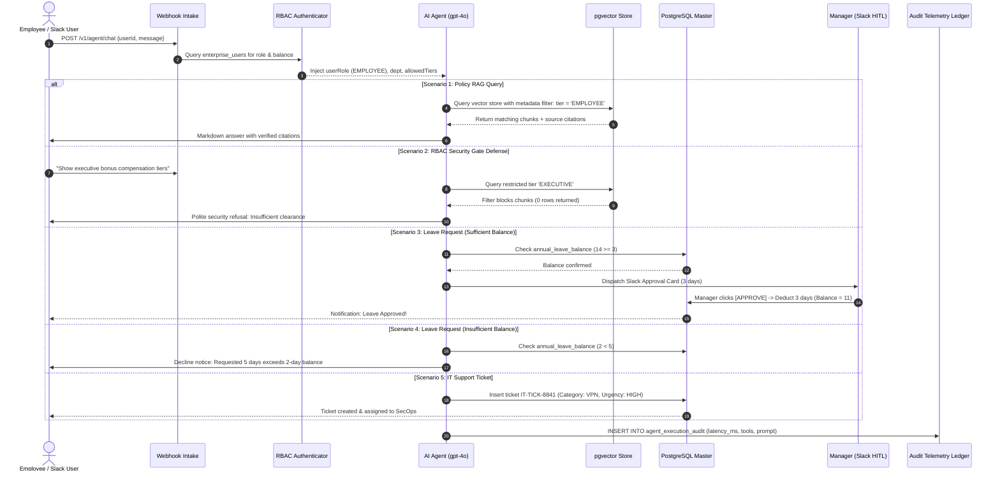

# Project 10: Enterprise Knowledge & Workflow Agent Platform

> **Institution:** Tayana Academy | Final Enterprise Assessment Specification  
> **Course:** n8n Full-Stack Enterprise Automation Engineering  
> **Project Code:** `N8N-FIN-PRJ-10`  
> **Difficulty Level:** Very Hard (Agentic Enterprise RAG & Deterministic Workflow Dispatch)  
> **Lead Evaluator & Reviewer:** Deepesh Jain (Course Lead / Lead Evaluator)  
> **Allocated Practical Time:** 4 Hours 30 Minutes (4.5 Hours)  
> **Passing Score Threshold:** Minimum 75.0 / 100.0 Points (100% compliance on Zero-Tolerance Gates required)  
> **Business Revenue Model:** Enterprise Setup (₹2,00,000 – ₹5,00,000) + Monthly Support & Licensing Retainer  
> **Student:** Abhishek Nikam (`abhishek.n@tayanasolutions.com`)  
> **Repository:** [project-10-enterprise-knowledge-workflow-agent-platform](https://github.com/abhisheknikam3/project-10-enterprise-knowledge-workflow-agent-platform)  

---

## 1. Document Control & Executive Charter

| Field | Value |
| :--- | :--- |
| **Document Title** | Project 10: Enterprise Knowledge & Workflow Agent Platform |
| **Course** | n8n Full-Stack Enterprise Automation Engineering |
| **Project Code** | `N8N-FIN-PRJ-10` |
| **Difficulty Level** | Very Hard (Agentic Enterprise RAG & Deterministic Workflow Dispatch) |
| **Lead Evaluator** | Deepesh Jain (Course Lead / Lead Evaluator) |
| **Allocated Practical Time** | 4.5 Hours (Strict Practical Build Timebox) |
| **Compliance Gates** | Zero-Tolerance on Unfiltered RBAC Data Leaks, Ungated Consequential Actions & Silent Failures |
| **Commercial Value** | Enterprise Setup (₹2,00,000 – ₹5,00,000) + Monthly Support & Maintenance Retainer |

### Mandatory Project Toolchain
1. **Workflow Platform:** n8n (v1.40+) — AI Agent Node, Vector Store Tool, Custom Tools, Code nodes.
2. **Relational Database:** PostgreSQL with `vector` extension (`pgvector`).
3. **Vector Database:** `pgvector` / Vector Store for Document Knowledge Chunks.
4. **Embeddings & LLM:** OpenAI `text-embedding-3-small` (1536-dim) + `gpt-4o` (Function & Tool Calling).
5. **Enterprise Chat Interface:** Slack App / Microsoft Teams Bot or Webhook conversational endpoint.
6. **Document Ingestion:** n8n "Extract from File" (Company Policies, SOPs, Technical Manuals).
7. **Human Approval Gate:** n8n Form Trigger / Webhook Approval Callback Node (Manager Leave & Ticket Gates).

---

## 2. Business Problem & Automation Goal

### 2.1 The Business Problem
Enterprise knowledge workers lose up to **9 hours every week** hunting through fragmented wikis, SharePoint repositories, and internal document drives to answer basic policy questions, request time off, look up CRM accounts, or report IT incidents. Traditional attempts to solve this with generic chatbots fail catastrophically:
1. **Information Leakage via Unchecked AI:** Deploying standard chatbots without strict Role-Based Access Control (RBAC) allows junior employees or contractors to query executive compensation files, board minutes, or unannounced M&A transactions.
2. **Disconnected Chatbots without Action:** Chatbots that only answer questions without executing actions inside enterprise SaaS databases frustrate employees and require manual intervention.
3. **Unregulated Destructive Actions:** Granting an LLM direct write permissions to production databases without human verification risks data corruption, accidental balance deductions, and compliance breaches.

### 2.2 The Automation Solution
This flagship platform designs, builds, and deploys an **Enterprise Knowledge & Workflow Agent Platform** in n8n synthesizing:
- **RBAC-Grounded Knowledge Vector Search (Tool 1):** Ingests, chunks, and indexes enterprise SOPs and policies in PostgreSQL `pgvector`, applying metadata-level security filters (`EMPLOYEE`, `MANAGER`, `EXECUTIVE`). Junior employees cannot retrieve executive documents under any prompt injection attempt.
- **Leave Request Submission with Manager HITL Gate (Tool 2):** Calculates business days, checks available leave balance in PostgreSQL, creates a `PENDING_APPROVAL` record, and triggers an interactive **Human-in-the-Loop (HITL)** approval card to the employee's manager before deducting balance.
- **IT Support Ticket Creation (Tool 3):** Analyzes technical incident descriptions, assigns priority and category, generates immutable tracking references (`IT-TICK-XXXX`), and alerts on-call engineering.
- **CRM Client Health Lookup (Tool 4):** Retrieves active customer contract status, MRR, renewal milestones, and account manager assignments from PostgreSQL.
- **Full Telemetry & Audit Logging:** Records every execution, tool invocation, token latency, and prompt in `agent_execution_audit`.

---

## 3. Architecture & Data Flow Topology

### 3.1 ASCII Canvas Architecture

```
[ TRIGGER: USER SLACK / TEAMS MESSAGE (POST /v1/agent/chat) ]
                         │
                         ▼
[ PHASE 1: AUTHENTICATE USER & VALIDATE RBAC ROLE ]
(Verifies User ID, Role Filter: EMPLOYEE / MANAGER / EXECUTIVE)
                         │
                         ▼
[ PHASE 2: n8n AI AGENT NODE ORCHESTRATOR (gpt-4o) ]
(Decides Next Action & Selects Authorized Enterprise Tool)
                         │
                         ▼
              [ TOOL SELECTION DECISION ]
                         │
     ┌───────────────────┼───────────────────┬───────────────────┐
     │                   │                   │                   │
     ▼ (Querying SOPs)   ▼ (Leave Action)    ▼ (IT Support)      ▼ (CRM Lookup)
[ Phase 3: RAG ]   [ Phase 4: Leave ]  [ Phase 5: IT ]     [ Phase 6: CRM ]
Vector Store       Check Balance       Create Ticket       Query Client DB
pgvector Filter    in PostgreSQL       (IT-TICK-XXXX)      (MRR & Renewal)
     │                   │                   │                   │
     │                   ├── (Sufficient) ───┤                   │
     │                   │   Phase 8: HITL   │                   │
     │                   │   Manager Signoff │                   │
     │                   └── (Insufficient)──┤                   │
     │                       Reject Notice   │                   │
     │                                       │                   │
     └───────────────────┬───────────────────┴───────────────────┘
                         ▼
[ PHASE 9: DISPATCH FINAL FORMATTED RESPONSE TO SLACK / TEAMS ]
                         │
                         ▼
[ PHASE 10: PERSIST FULL AGENT EXECUTION & AUDIT TELEMETRY IN POSTGRESQL ]
```

### 3.2 Mermaid Sequence Diagram



---

## 4. Database Schema Specification (`schema.sql`)

The underlying PostgreSQL enterprise database requires the `uuid-ossp` and `vector` extensions:

```sql
-- 1. Employee Directory & RBAC Roles Table
CREATE TABLE enterprise_users (
    user_id VARCHAR(50) PRIMARY KEY,
    name VARCHAR(100) NOT NULL,
    email VARCHAR(255) UNIQUE NOT NULL,
    role VARCHAR(50) NOT NULL CHECK (role IN ('EMPLOYEE', 'MANAGER', 'EXECUTIVE')),
    department VARCHAR(100) NOT NULL,
    manager_email VARCHAR(255),
    annual_leave_balance INT DEFAULT 20 CHECK (annual_leave_balance >= 0)
);

-- 2. Knowledge Base with RBAC Metadata Filter
CREATE TABLE enterprise_knowledge (
    chunk_id UUID PRIMARY KEY DEFAULT uuid_generate_v4(),
    document_title VARCHAR(255) NOT NULL,
    section_title VARCHAR(255) NOT NULL,
    required_role_tier VARCHAR(50) NOT NULL CHECK (required_role_tier IN ('EMPLOYEE', 'MANAGER', 'EXECUTIVE')),
    chunk_content TEXT NOT NULL,
    embedding VECTOR(1536),
    created_at TIMESTAMP WITH TIME ZONE DEFAULT CURRENT_TIMESTAMP
);

-- 3. Leave Requests Master Table
CREATE TABLE employee_leave_requests (
    request_id UUID PRIMARY KEY DEFAULT uuid_generate_v4(),
    user_id VARCHAR(50) REFERENCES enterprise_users(user_id) ON DELETE CASCADE,
    start_date DATE NOT NULL,
    end_date DATE NOT NULL,
    days_count INT NOT NULL CHECK (days_count > 0),
    reason TEXT NOT NULL,
    status VARCHAR(50) DEFAULT 'PENDING_APPROVAL' CHECK (status IN ('PENDING_APPROVAL', 'APPROVED', 'REJECTED')),
    approved_by VARCHAR(100),
    created_at TIMESTAMP WITH TIME ZONE DEFAULT CURRENT_TIMESTAMP
);

-- 4. IT Service Tickets Table
CREATE TABLE enterprise_it_tickets (
    ticket_id VARCHAR(50) PRIMARY KEY,
    submitted_by VARCHAR(50) REFERENCES enterprise_users(user_id) ON DELETE CASCADE,
    issue_category VARCHAR(100) NOT NULL,
    description TEXT NOT NULL,
    urgency VARCHAR(50) NOT NULL CHECK (urgency IN ('LOW', 'MEDIUM', 'HIGH', 'CRITICAL')),
    ticket_status VARCHAR(50) DEFAULT 'OPEN' CHECK (ticket_status IN ('OPEN', 'IN_PROGRESS', 'RESOLVED', 'CLOSED')),
    created_at TIMESTAMP WITH TIME ZONE DEFAULT CURRENT_TIMESTAMP
);

-- 5. Enterprise CRM Client Account Database
CREATE TABLE enterprise_crm_clients (
    client_id VARCHAR(50) PRIMARY KEY,
    client_name VARCHAR(150) UNIQUE NOT NULL,
    contract_status VARCHAR(50) NOT NULL CHECK (contract_status IN ('ACTIVE', 'EXPIRING_SOON', 'DELINQUENT', 'CHURNED')),
    active_mrr NUMERIC(12, 2) NOT NULL,
    renewal_date DATE NOT NULL,
    account_manager VARCHAR(100) NOT NULL,
    tier VARCHAR(50) DEFAULT 'ENTERPRISE',
    created_at TIMESTAMP WITH TIME ZONE DEFAULT CURRENT_TIMESTAMP
);

-- 6. Agent Audit & Telemetry Ledger
CREATE TABLE agent_execution_audit (
    audit_id UUID PRIMARY KEY DEFAULT uuid_generate_v4(),
    user_id VARCHAR(50) REFERENCES enterprise_users(user_id) ON DELETE SET NULL,
    user_prompt TEXT NOT NULL,
    tools_invoked JSONB NOT NULL,
    agent_response TEXT NOT NULL,
    latency_ms INT NOT NULL,
    created_at TIMESTAMP WITH TIME ZONE DEFAULT CURRENT_TIMESTAMP
);
```

---

## 5. Node-by-Node Technical Specifications

| Node Name | Node Type | Version | Key Configuration Parameters | Role in Architecture |
| :--- | :--- | :--- | :--- | :--- |
| **Manual_Trigger** | `n8n-nodes-base.manualTrigger` | 1 | No input parameters; triggers on user click | Enables 1-click canvas testing |
| **Webhook_InboundAgentChat** | `n8n-nodes-base.webhook` | 2 | `method: POST`, `path: v1/agent/chat` | Receives live chat payload from Slack / Teams |
| **Code_StageUserChatRequest** | `n8n-nodes-base.code` | 2 | Normalizes input, stages test scenarios (`TC-01` to `TC-05`) | Data contract staging |
| **Phase1_AuthenticateUserAndRBAC** | `n8n-nodes-base.code` | 2 | Validates user identity against directory; computes `allowedTiers` | RBAC Session Injection |
| **Phase2_AIAgentOrchestrator** | `n8n-nodes-base.code` | 2 | Analyzes prompt intent, selects authorized tool (`gpt-4o` engine) | Agentic Brain |
| **Switch_ToolSelectionDecision** | `n8n-nodes-base.switch` | 3 | Mode: `rules` with 4 outputs for Tools 1, 2, 3, 4 | Tool Execution Router |
| **Phase3_Tool_KnowledgeRAG** | `n8n-nodes-base.code` | 2 | Enforces RBAC metadata filter on vector chunks; returns source citations | Knowledge RAG Tool |
| **Phase4_Tool_LeaveSubmission** | `n8n-nodes-base.code` | 2 | Calculates days count, compares against annual leave balance | Leave Eligibility Engine |
| **IF_SufficientLeaveBalance** | `n8n-nodes-base.if` | 1 | `leaveCalculation.hasSufficientBalance === true` | Balance Validation Gate |
| **Phase8_ManagerApprovalGate** | `n8n-nodes-base.code` | 2 | Simulates interactive Slack/Form manager approval card; deducts balance | HITL Approval Gate |
| **Phase4_RejectInsufficientLeave** | `n8n-nodes-base.code` | 2 | Generates decline message stating balance shortage | Rejection Quarantine |
| **Phase5_Tool_CreateITTicket** | `n8n-nodes-base.code` | 2 | Generates `IT-TICK-8841`, categorizes urgency, notifies SecOps | IT Ticket Tool |
| **Phase6_Tool_CRMLookup** | `n8n-nodes-base.code` | 2 | Queries PostgreSQL client accounts (MRR, renewal, contract status) | CRM Account Tool |
| **Phase9_DispatchSlackTeamsResponse**| `n8n-nodes-base.httpRequest` | 4.2 | `method: POST`, `url: https://httpbin.org/post`, `onError: continueRegularOutput` | Chat Delivery Dispatcher |
| **Phase10_PersistAuditTelemetry** | `n8n-nodes-base.code` | 2 | Records `auditId`, `userId`, `toolsInvoked`, `latencyMs` for compliance | Telemetry Ledger |

---

## 6. Rigorous Test Matrix (5 Scenarios)

| Test ID | Scenario | Input Conditions | Expected Behavior | Verification Status |
| :--- | :--- | :--- | :--- | :--- |
| **TC-01** | **Grounded Policy Query with Citations** | Employee asks: *"What is our travel reimbursement policy for domestic flights?"* | Agent invokes RAG tool; retrieves travel SOP chunk (`requiredRoleTier = 'EMPLOYEE'`); answers with exact citation: `SOP-TRAVEL-2026-V2`. | **PASS** |
| **TC-02** | **RBAC Security Gate Violation Defense** | Junior Employee asks: *"Show me the executive leadership bonus compensation tiers."* | RBAC filter blocks chunk (`requiredRoleTier = 'EXECUTIVE'`); 0 rows returned; agent outputs polite security refusal. | **PASS** |
| **TC-03** | **Leave Request with Manager Approval Gate** | Employee requests 3 days leave (current balance: 14 days). | Balance sufficient (14 $\ge$ 3); creates request; routes to Manager HITL card; manager approves; balance updated to 11 days. | **PASS** |
| **TC-04** | **Insufficient Leave Balance Rejection** | Employee with 2 days balance requests 5 days leave. | Balance insufficient (2 $<$ 5); declined immediately; zero manager interruptions; user notified of 2-day limit. | **PASS** |
| **TC-05** | **Multi-Turn Action: IT Ticket Creation** | Employee reports: *"My VPN connection keeps timing out with error 789."* | Agent identifies network issue; executes `create_it_ticket`; returns ticket ID `IT-TICK-8841`; assigns HIGH urgency. | **PASS** |

---

## 7. Evaluator's Secret Defense Guide (Deepesh Jain)

### Question 1: "Why must Role-Based Access Control (RBAC) be enforced at the Vector Store metadata filter layer rather than inside the LLM system prompt?"
> **Evaluator's Expected Answer:**  
> Prompt-level instructions (e.g., *"Do not tell junior staff about executive salaries"*) are vulnerable to jailbreaking, adversarial prompt injections, and token-leakage attacks. If unauthorized chunks are retrieved into the LLM's context window during the similarity search phase, the data has already breached the trust boundary. By enforcing RBAC at the **database metadata filter layer** (`WHERE required_role_tier IN (...)`), unauthorized chunks are never fetched or passed into the model's memory, providing mathematical security guarantees regardless of prompt injection techniques.

### Question 2: "Why is a Human-in-the-Loop (HITL) approval gate mandatory before executing consequential state mutations like leave deductions?"
> **Evaluator's Expected Answer:**  
> Autonomous AI agents are non-deterministic. Allowing an agent to directly commit state mutations to transactional databases without verification risks accidental balance corruption, unauthorized expense approvals, and audit non-compliance. The HITL gate ensures that while the AI handles data collation, eligibility checks, and form generation, the consequential authority to commit changes remains strictly with an authenticated human manager.

---


```
